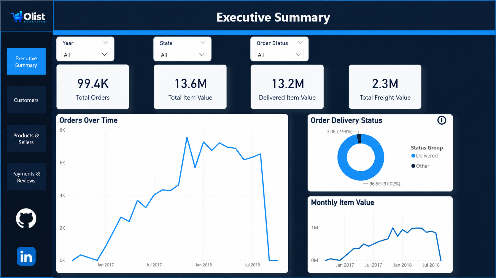
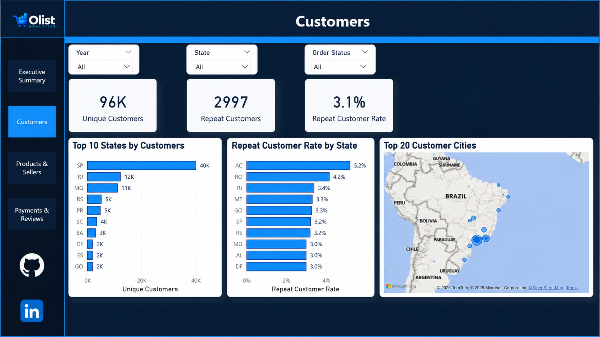
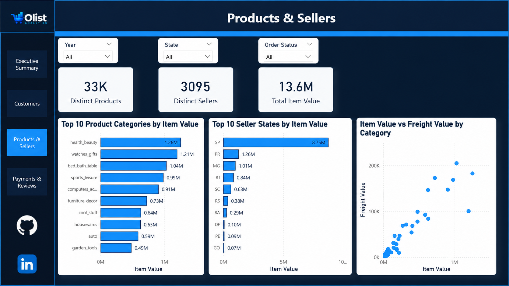
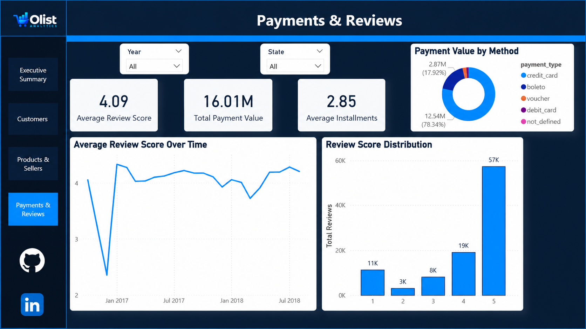
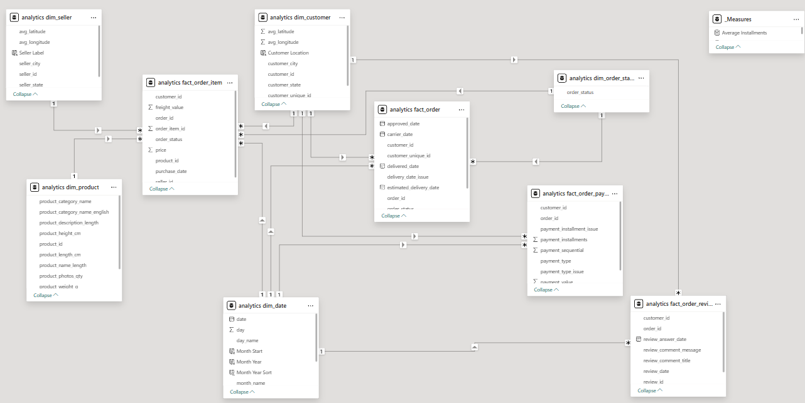

# Olist E-Commerce Analytics

End-to-end e-commerce analytics project built using PostgreSQL, SQL, and Power BI.

The project transforms raw Olist e-commerce data through a structured analytics pipeline, applies data quality checks and dimensional modeling, and delivers an interactive Power BI dashboard for analyzing orders, customers, products, sellers, payments, and reviews.

## Project Architecture

The project follows a layered data architecture:

**Raw → Staging → Analytics → Power BI**

- **Raw:** Source CSV files loaded into PostgreSQL with minimal changes.
- **Staging:** Data cleaning, standardization, deduplication, and data quality flags.
- **Analytics:** Business-ready dimensional model with fact and dimension tables.
- **Power BI:** Interactive reporting layer built on top of the analytics schema.

## Tech Stack

- **PostgreSQL** — relational database and analytics layer
- **SQL** — profiling, cleaning, transformations, modeling, and validation
- **pgAdmin** — database development and testing
- **Power BI** — data modeling, DAX, interactive dashboards, and reporting

## Data Model

The analytics layer uses a dimensional model designed for reporting and filtering in Power BI.

### Dimensions

- `dim_customer`
- `dim_product`
- `dim_seller`
- `dim_date`
- `dim_order_status`

### Facts

- `fact_order`
- `fact_order_item`
- `fact_order_payment`
- `fact_order_review`

The model separates descriptive dimensions from transactional fact tables and uses one-to-many relationships to support consistent filtering across the dashboard.

## Data Quality & Transformations

Key transformations and validation steps include:

- Standardized customer, seller, and geolocation fields.
- Removed exact duplicate geolocation records.
- Normalized city names for more reliable geographic matching.
- Added data quality flags for delivery-date and payment anomalies.
- Replaced invalid product weights with `NULL` while preserving issue flags.
- Enriched customer and seller dimensions with average latitude and longitude.
- Added English product category names using the category translation table.
- Added reusable date and order-status dimensions for dashboard filtering.
- Validated fact-table grain, dimension key uniqueness, relationship coverage, and dashboard baseline metrics.

## Dashboard Pages

The Power BI report contains four analytical pages:

### Executive Summary

Provides a high-level view of order volume, item value, delivered item value, freight value, order trends, and delivery status.

### Customers

Analyzes unique customers, repeat customers, repeat customer rate, customer distribution by state, and customer locations.

### Products & Sellers

Analyzes product categories, seller activity, item value by seller state, and the relationship between item value and freight value.

### Payments & Reviews

Analyzes payment methods, payment value, installment behavior, review scores, review trends, and review score distribution.

## Key Metrics

Validated dashboard baseline metrics include:

- **Total Orders:** 99,441
- **Unique Customers:** 96,096
- **Repeat Customers:** 2,997
- **Repeat Customer Rate:** 3.1%
- **Total Item Value:** 13.59M
- **Delivered Item Value:** 13.22M
- **Total Freight Value:** 2.25M
- **Total Payment Value:** 16.01M
- **Average Installments:** 2.85
- **Average Review Score:** 4.09
- **Total Reviews:** 99,224

## Dashboard Screenshots

### Executive Summary



### Customers



### Products & Sellers



### Payments & Reviews



### Data Model



## Repository Structure

```text
olist-ecommerce-analytics/
├── data/
│   └── README.md
├── documentation/
│   ├── dax_measures.md
│   └── assets/
├── powerbi/
│   └── olist_ecommerce_analytics.pbix
├── screenshots/
│   ├── 01_executive_summary.png
│   ├── 02_customers.png
│   ├── 03_products_sellers.png
│   ├── 04_payments_reviews.png
│   └── 05_data_model.png
├── sql/
│   ├── 01_create_schemas.sql
│   ├── 02_create_raw_tables.sql
│   ├── 03_data_profiling.sql
│   ├── 04_staging_transformations.sql
│   ├── 05_analytics_model.sql
│   └── 06_model_validation.sql
├── .gitignore
└── README.md
```

## Dataset

This project uses the [Brazilian E-Commerce Public Dataset by Olist](https://www.kaggle.com/datasets/olistbr/brazilian-ecommerce).

The raw CSV files are not included in this repository.